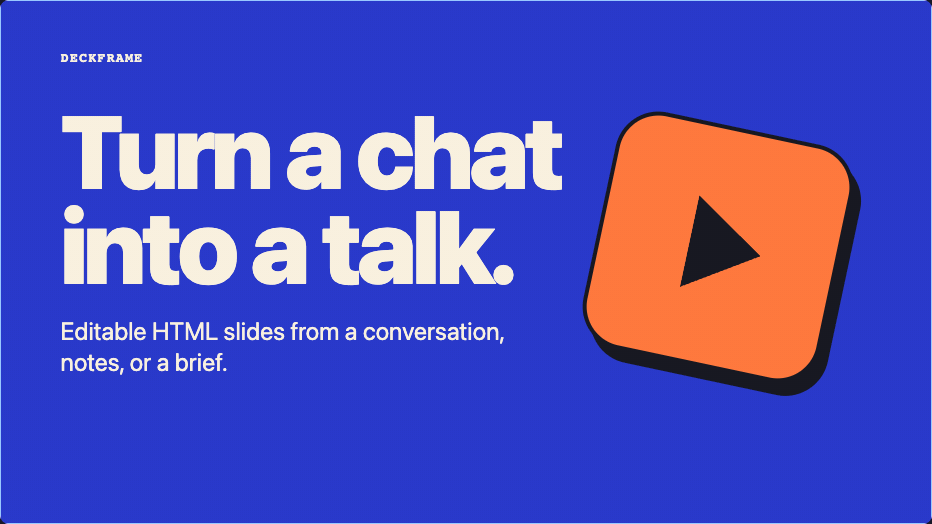

# Deckframe

**Turn a conversation into an editable HTML presentation.**

Deckframe is an Agent Skill for making short talks from chats, notes, and briefs. Advance a slide with the arrow keys, reveal a point when you’re ready to discuss it, or carry the same visual into the next slide. Open the finished deck directly in a browser and edit its HTML and CSS when the story changes.



[Download the skill ZIP](dist/deckframe.zip) · [Download the demo deck](dist/deckframe-demo.zip) · [Read the authoring guide](skills/deckframe/references/authoring.md)

## Try the demo

Unzip the demo and open `intro/index.html`. Press **→** to advance or reveal the next point, **←** to go back, and **Home** to restart. The numbered buttons jump to specific slides.

The GIF above comes from that same deck. Its orange play tile moves between slides because each copy has the same `data-morph` name. The line on slide two uses `data-step` so the presenter decides when it appears.

## Use Deckframe with your assistant

The same [Agent Skills folder](skills/deckframe/) supplies the instructions, starter files, motion reference, and optional GIF exporter. Choose the setup that matches your host.

| Host | Setup |
| --- | --- |
| **Claude** | Upload [`deckframe.zip`](dist/deckframe.zip) in **Customize → Skills** where custom skills and code execution are available. [Claude setup](https://support.claude.com/en/articles/12512180-use-skills-in-claude) |
| **Claude Code** | Copy the extracted `deckframe/` folder to `~/.claude/skills/` or your project’s `.claude/skills/`. Invoke `/deckframe`. [Claude Code setup](https://code.claude.com/docs/en/skills) |
| **ChatGPT** | If your workspace has Skills and permits uploads, use **Plugins → Skills → Create → Upload from your computer** and select the package. If Skills is unavailable, use the file-based workflow below. [ChatGPT setup](https://help.openai.com/en/articles/20001066-skills-in-chatgpt) |
| **Codex** | Copy the extracted `deckframe/` folder to `~/.agents/skills/` or your project’s `.agents/skills/`. Invoke `$deckframe`. [Codex setup](https://learn.chatgpt.com/docs/build-skills#where-codex-loads-local-skills) |
| **Other assistants** | Use your host’s Agent Skills installer if it supports the [standard](https://agentskills.io/specification). Otherwise, use the file-based workflow below. |

In a chat with file access but no skill installer, give the assistant the extracted skill files and ask it to follow `SKILL.md`. If the chat cannot open a ZIP, share `SKILL.md` and `references/authoring.md` directly. Ask for the deck’s `index.html` and any theme CSS, then copy the runtime files from `assets/` beside it. Add the motion stylesheet from that folder if the deck uses a Motion Library effect.

A prompt to try after installing or attaching the skill:

> Use Deckframe to turn these meeting notes into a four-slide talk. Reveal the decision on cue. Carry one recognizable visual from the problem slide into the solution. Return the editable HTML deck.

## Build or edit a deck by hand

Copy [`starter.html`](skills/deckframe/assets/starter.html) as `index.html` and put `deckframe.css` and `deckframe.js` beside it. Edit the slide markup and keep any media next to the deck using relative paths.

| Markup | Behavior |
| --- | --- |
| `<section data-slide>` | Adds a slide inside the stage. Give it an ID to link directly to it. |
| `data-step` | Hides the element until the presenter advances to its reveal. |
| `data-morph="play-tile"` | Carries a visual between slides that use the same morph name. |
| `data-transition="fade"` | Chooses the incoming scene transition. The runtime also includes slide, wipe, and cut. |

Deckframe uses browser-native view transitions for shared motion. Reduced motion and browsers without that API apply the slide change immediately. See the [Motion Library](skills/deckframe/references/motion-library.md) for additional effects.

## Export a looping GIF

The optional exporter needs Node.js, Playwright with Chromium or an installed Chrome, and FFmpeg on your PATH. Run this from a checkout with those tools available:

```sh
node skills/deckframe/scripts/export-gif.cjs examples/intro/index.html deckframe-demo.gif \
  --width 960 --hold-ms 2500 --fps 16
```

The exporter advances through slides and reveals, samples the animations, and crops out the controls. Use `--playwright` and `--browser` if the installations need explicit paths. See the [GIF export guide](skills/deckframe/references/gif.md) for details.

When publishing a package update, rebuild the skill ZIP from `skills/` so `deckframe/SKILL.md` is at the expected path. Rebuild the demo ZIP separately from `examples/`.

```sh
rm -f dist/deckframe.zip dist/deckframe-demo.zip
(cd skills && zip -qr ../dist/deckframe.zip deckframe)
(cd examples && zip -qr ../dist/deckframe-demo.zip intro)
```
